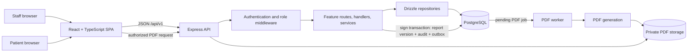
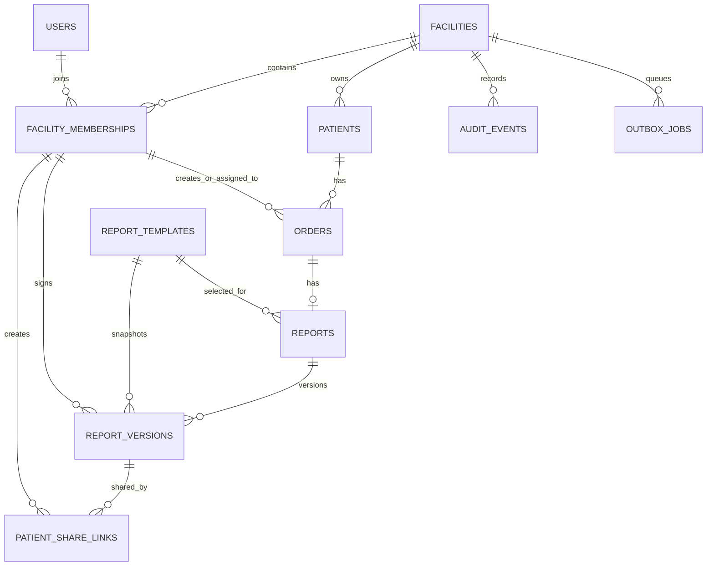

# Cloud Reporting Tool — System Design

## Purpose and scope

This document describes the current implementation of the Cloud Reporting Tool. It is an imaging-centre workflow and reporting application: staff register patients, create and assign imaging orders, radiologists author reports, and patients receive access to signed report PDFs.

The application does **not** ingest, store, or view CT/PET/MRI image data and does not interpret scans or produce diagnoses. A clinician authors and signs the report.

## Architecture

The project uses a modular-monolith design. The frontend, HTTP API, and PDF worker are separate runtime processes but share one repository and domain model. PostgreSQL stores workflow data; a configurable private storage provider stores generated PDF files.



### Technology and responsibility

| Component | Technology | Responsibility |
| --- | --- | --- |
| Web client | React, TypeScript, React Router `HashRouter`, esbuild | Staff workspace, patient report view, form validation, role-aware navigation |
| API | Node.js, TypeScript, Express | Authentication, authorization, input validation, workflow rules, JSON and PDF responses |
| Database | PostgreSQL, Drizzle ORM | Tenant-scoped staff, patient, order, report, audit, sharing, and outbox records |
| PDF worker | Node.js process using backend modules | Polls the outbox, generates PDFs, uploads them, and records status |
| PDF storage | Supabase Storage, GCS, or local adapter | Stores generated PDFs; API serves them after authorization |

### Backend module boundaries

Feature modules follow a route → handler → service → repository pattern:

- **Routes** map HTTP methods and paths to handlers and apply authentication/role middleware.
- **Handlers** parse and validate HTTP input, call services, and create the standard response envelope.
- **Services** enforce business rules and authorization decisions for their workflow.
- **Repositories** perform database operations through Drizzle.
- **Shared code** contains database schema/connection, repositories, authentication middleware, response helpers, pagination, and PDF storage adapters.

The API router is composed in [`backend/src/router.ts`](../backend/src/router.ts). The main feature modules are authentication, staff, patients, orders, report templates, reports, and sharing.

### API conventions

JSON endpoints return:

```json
{
  "meta": { "status": "success", "message": "Request successful" },
  "data": {}
}
```

Errors use the same envelope with `meta.status` set to `"error"`. List endpoints return rows as `data: []` and use `X-Next-Cursor` for pagination. PDF endpoints return binary `application/pdf` responses rather than JSON.

All feature routes are mounted under `/api/v1`. The API entry point also exposes `/health`.

## Database design

The schema is defined in [`backend/shared/db/schema.ts`](../backend/shared/db/schema.ts); migrations live under `backend/shared/db`.

### Entity relationships



`FACILITY_MEMBERSHIPS` is the many-to-many link between global staff users and facilities. Most workflow records carry a `facility_id`; queries and composite foreign keys keep patient/order/report relationships within the same facility.

### Tables

| Table | Key data | Purpose and constraints |
| --- | --- | --- |
| `facilities` | `id`, `name`, `address`, `phone` | Facility identity and contact details used in report PDFs. |
| `users` | `id`, unique `email`, `password_hash`, `active` | Staff identity and bcrypt password hash. |
| `facility_memberships` | `facility_id`, `user_id`, `role`, `active` | Facility-specific role and access state; unique per facility/user pair. Roles are `front_desk`, `radiologist`, and `facility_admin`. |
| `patients` | `facility_id`, `medical_record_number`, names, date of birth, `deleted_at` | Facility-scoped patient directory. MRN is unique per facility; delete requests archive records using `deleted_at`. |
| `orders` | `facility_id`, `patient_id`, accession, modality, procedure, priority, status, creator, assigned radiologist | Worklist item. Accession is unique per facility; composite foreign keys enforce facility-consistent patient and membership references. |
| `report_templates` | `facility_id`, name, version, JSONB `sections`, `active`, creator | Structured report template. Each section has a key, label, and required flag. |
| `reports` | `facility_id`, `order_id`, `template_id`, JSONB `draft_content`, status, latest version | Mutable working draft; one report per order and facility. |
| `report_versions` | `facility_id`, `report_id`, `version_number`, JSONB content, amendment reason, signer, signed time, PDF state/path/checksum | Signed report snapshots; version number is unique within a report. Application workflow treats signed versions as historical records. |
| `patient_share_links` | `facility_id`, report version, `token_hash`, creator, expiry, revocation/access timestamps | A bearer link is scoped to one report version. The database stores a token hash, not the raw URL token. |
| `audit_events` | `facility_id`, actor, action, resource, JSONB metadata, timestamp | Records notable workflow actions such as report signing and patient access changes. |
| `outbox_jobs` | `facility_id`, job type, JSONB payload, status, attempts, availability/lock/completion times, last error | Durable queue for PDF generation, written in the same transaction as report signing. |

Important enums include:

- Order status: `unassigned`, `assigned`, `in_progress`, `reported`, `cancelled`.
- Report status: `draft`, `signed`.
- PDF status: `pending`, `processing`, `ready`, `failed`.
- Outbox job status: `pending`, `processing`, `completed`, `failed`.

The schema includes facility/status/created-time and facility/assignee/status/created-time order indexes. Patient MRN/name and order accession search use PostgreSQL trigram indexes.

## Authentication and tenant isolation

1. Staff login submits email, password, and the facility context. The backend checks the user’s active membership in that facility and verifies the password hash.
2. The API issues a short-lived JWT containing the user, facility, and role context.
3. Staff requests send the JWT as a bearer token. Middleware verifies it and rechecks that the facility membership is still active.
4. Services scope data access to the facility from the authenticated identity. Radiologists are further restricted to assigned orders and reports.

The browser stores the staff token in `sessionStorage` for this POC. The login form hides the facility UUID; the frontend receives it from `VITE_DEFAULT_FACILITY_ID` in the ignored local `frontend/.env`. Client-side route guards improve navigation but do not replace backend authorization.

## Application flow

### 1. Start the application

Apply database migrations and seed demo records. Run three processes during local development:

```sh
npm run dev -w backend
npm run worker -w backend
npm run dev -w frontend
```

The API and PDF worker load backend configuration from `backend/.env`; the frontend build helper injects the API URL and default facility into its runtime config.

### 2. Sign in and open the worklist

Staff sign in with their account. Navigation and actions depend on role. The worklist supports status, modality, text search, and cursor pagination. Radiologist queries are scoped to orders assigned to the signed-in radiologist.

### 3. Register a patient and create an order

Front-desk staff or a facility administrator can create or update a patient record. They create an order with the patient, modality, procedure, and priority. New orders start as `unassigned`. Staff assign an active facility radiologist, moving the order to `assigned`.

### 4. Author and sign a report

The assigned radiologist starts the order, changing it to `in_progress`, and creates a draft using a facility report template. Required sections are validated by the API. Drafts can be saved and edited. Signing creates a numbered signed version; amendments create a later version and require an amendment reason. The order moves to `reported`.

### 5. Generate and retrieve the PDF

The sign operation writes the signed version, updates report/order state, records an audit event, and inserts a `generate_report_pdf` outbox job in one database transaction. The separate worker polls every 250 ms, renders the PDF with the facility logo/name/address/phone, writes it through the selected storage adapter, and marks the version `ready`. Failures are recorded and retried up to the configured attempt limit.

Staff retrieve PDFs through an authenticated API route; the bucket/object is not public. The order page displays PDF status and can be refreshed while the worker is processing.

### 6. Share a report with a patient

After the PDF is ready, front-desk staff or a facility administrator can create a share link from the order screen. The current UI does not expose this action to radiologists, although the backend also allows an assigned radiologist to create a link. The default UI expiry is 72 hours.

The patient opens the link without a staff login. The frontend exchanges the URL token for a short-lived, report-version-scoped access token and retrieves the PDF through the API. Links can be revoked; access is rate-limited and recorded.

### 7. Facility administration

Facility administrators can view and activate/deactivate radiologist memberships and create report templates. Deactivated memberships are rejected by authentication middleware even if the user still has an unexpired JWT.

## Role capabilities

| Role | Main capabilities |
| --- | --- |
| Front desk | Manage patients, create/assign/cancel eligible orders, create patient share links, view worklist/order information. |
| Radiologist | View assigned orders, start studies, draft/save/sign/amend reports, retrieve assigned report PDFs. |
| Facility admin | Facility-wide workflow access, staff membership management, template creation, and report administration. |
| Patient | No staff account; view/download only the signed PDF version allowed by their active share link. |

API permissions are enforced server-side. The role table is a summary; exact endpoint policies are declared in feature route modules.

## PDF storage

`STORAGE_TO_USE` selects one provider:

- `SUPABASE_STORAGE`: Supabase Storage.
- `GCP_STORAGE`: Google Cloud Storage.
- `LOCAL_STORAGE`: local filesystem for development.

The PDF worker writes to storage and the API reads from the same provider after authorization. Provider credentials remain in backend environment configuration and must not be added to source control. The storage abstraction is in [`backend/shared/storage/report_storage.ts`](../backend/shared/storage/report_storage.ts).

## Current limitations and operational notes

- Scan images, PACS/DICOM, external EHR integrations, notifications, and patient accounts are outside the current POC.
- PDF creation requires the separate worker process; starting only the API and frontend leaves jobs queued.
- The frontend config is generated when the frontend server starts. Changes to `frontend/.env` require a frontend restart.
- The implementation is intended for synthetic/demo data. It has not been validated for regulated production use, high availability, or the performance targets in [`architecture.md`](./architecture.md).
- Before production, review token storage, privacy/security controls, deployment secrets, backups/restore, monitoring, and clinical governance.

## Related documentation

- [`architecture.md`](./architecture.md) — original assignment analysis, target architecture, delivery plan, and performance targets.
- [`current-session-summary.md`](./current-session-summary.md) — concise project handoff for this chat session; it is not a verbatim transcript.
